# 1. Cover Page

**VISVESVARAYA TECHNOLOGICAL UNIVERSITY, BELAGAVI**

**MLOps Mini Project Report**

# ChurnSense: Customer Churn Prediction and Retention Intelligence System

Submitted in partial fulfilment of the requirements for the Bachelor of Engineering in
**Computer Science and Engineering (Artificial Intelligence and Machine Learning)**

| | |
|---|---|
| **Submitted by** | [Student Name] |
| **USN** | [University Seat Number] |
| **Semester / Section** | [Semester / Section] |
| **Under the guidance of** | [Guide Name, Designation] |
| **Department** | Computer Science and Engineering (AI & ML) |
| **Institution** | [College Name, City] |
| **Academic Year** | [Academic Year] |

*The bracketed fields are placeholders to be completed by the student before submission.*

---

# 2. Abstract

Customer churn, the loss of customers who stop using a company's services, is costly for subscription
businesses such as telecommunications providers, because acquiring a new customer is usually more expensive than
retaining an existing one. This project presents **ChurnSense**, a machine-learning system that estimates the
probability that a customer will churn, and demonstrates how lightweight MLOps practices can be wrapped around
such a model.

The system uses the publicly available IBM Telco Customer Churn dataset (7,043 customer records, 21 columns).
Three scikit-learn classifiers, Logistic Regression, Random Forest and Gradient Boosting, are trained inside a
leak-free `Pipeline`/`ColumnTransformer` and tuned with `RandomizedSearchCV` using five-fold stratified
cross-validation. The final model is selected by cross-validated ROC-AUC, not by test-set performance. The selected
model, **Gradient Boosting**, reached a cross-validated ROC-AUC of 0.8503 and, on a 1,405-customer hold-out set,
an accuracy of 0.7993, precision of 0.6596, recall of 0.5000, F1-score of 0.5688 and ROC-AUC of 0.8426 for the
churn class.

Around the model, the project implements model versioning with Joblib, JSON/CSV experiment tracking,
Population-Stability-Index (PSI) data-drift checks, input validation, Python logging and a 33-test Pytest suite.
A five-page Streamlit dashboard provides an overview, single-customer prediction, batch prediction, model
performance and MLOps monitoring, including a safe retraining option. A small rule-based component offers
general retention suggestions. The monitoring is a basic academic implementation and is not production-grade.

**Keywords:** customer churn, classification, gradient boosting, MLOps, experiment tracking, data drift, PSI, Streamlit.

---

# 3. Introduction

Telecommunication and subscription companies operate in highly competitive markets where customers can switch
providers with little effort. Customer churn directly reduces recurring revenue, and the cost of winning a new
customer is typically higher than the cost of keeping an existing one. Companies therefore try to identify
customers who are likely to leave so that retention teams can prioritise their effort.

Machine learning supports this by learning patterns from historical customer records, such as contract type,
tenure and monthly charges, and producing a churn probability for each customer. However, a trained model is only
one part of a working solution. A model must be trained reproducibly, versioned, evaluated honestly, served to
users, and watched over time because the data it sees in practice can change. These activities are the subject of
**MLOps** (machine-learning operations), which applies software-engineering discipline to the machine-learning
life cycle. Sculley et al. (2015) argue that the surrounding system, rather than the model code, is often where
the long-term cost and risk of machine-learning systems lies.

This project builds a small but complete system, ChurnSense, that covers the life cycle end to end while staying
lightweight: no cloud services, no paid APIs and no specialised hardware.

---

# 4. Problem Description

A telecom provider holds records of its customers, including demographics, subscribed services, contract and
billing details, and whether the customer eventually left. Given such attributes for a customer, the system
must estimate how likely it is that the customer will churn.

Formally, this is a **binary classification** task. For an input vector **x** of customer attributes, the model
outputs P(Churn = Yes | **x**), from which a predicted label and a risk category are derived. The problem has the
following practical characteristics:

- **Class imbalance.** In the cleaned data, 26.45 % of customers churned and 73.55 % stayed.
- **Mixed data types.** Three numeric attributes and sixteen categorical attributes.
- **Data quality issues.** Blank values in `TotalCharges` and a small number of duplicate records.
- **Operational needs.** Predictions must be repeatable, models must be traceable to the data and settings that
  produced them, and users must be warned when new data differs from the training data.

---

# 5. Aim of the Project

To design, implement, test and document a reproducible machine-learning system that predicts customer churn from
the IBM Telco Customer Churn dataset and demonstrates fundamental MLOps practices (versioning, experiment tracking,
monitoring, logging and automated testing) through an interactive dashboard.

---

# 6. Literature Survey

This section reviews the techniques used in the project. It describes the foundational methods and engineering
practices on which the implementation relies. Churn-specific empirical studies were **not** surveyed for this
report; students who need a domain literature review should add one from their institution's accepted databases.

**Logistic regression.** Logistic regression models the log-odds of a binary outcome as a linear function of the
inputs; the classical formulation for binary data is due to Cox (1958). It is fast, stable and its coefficients are
interpretable, which makes it a standard baseline for churn-style problems.

**Random forests.** Breiman (2001) introduced random forests, ensembles of decision trees trained on bootstrap
samples with random feature subsets at each split. Averaging many decorrelated trees reduces variance and
generally gives strong accuracy with little tuning.

**Gradient boosting.** Friedman (2001) described gradient boosting, in which trees are added sequentially, each
fitted to the gradient of the loss of the current ensemble. It is a widely used method for tabular data and is
implemented in scikit-learn as `GradientBoostingClassifier`.

**Hyper-parameter search.** Bergstra and Bengio (2012) showed that randomly sampling hyper-parameter
configurations is often more efficient than exhaustive grid search, especially when only a few hyper-parameters
matter. This motivates the use of `RandomizedSearchCV` here to keep training time reasonable.

**Machine-learning systems and MLOps.** Sculley et al. (2015) describe how machine-learning systems accumulate
"technical debt" through entanglement, undeclared dependencies, data dependencies and configuration problems,
motivating practices such as versioning, testing, monitoring and reproducibility, which this project applies in
lightweight form.

**Population Stability Index.** The PSI compares the distribution of a variable in a new sample with a reference
distribution and is widely used in credit-risk scorecard monitoring (Siddiqi, 2006). A common rule of thumb treats
values below 0.10 as stable, 0.10 to 0.25 as moderate shift and above 0.25 as significant shift. These thresholds
are conventions, not statistical tests.

**Software toolkit.** Scikit-learn (Pedregosa et al., 2011) provides the estimators, pipelines, preprocessing and
model-selection utilities used in this project.

---

# 7. Objectives

1. Acquire and validate the real IBM Telco Customer Churn dataset and document its source.
2. Build a leak-free preprocessing pipeline (imputation, scaling, one-hot encoding).
3. Train and tune three classifiers (Logistic Regression, Random Forest, Gradient Boosting) with cross-validation.
4. Select the final model on validation (cross-validated) ROC-AUC and evaluate it once on an untouched test set.
5. Save versioned models with metadata, and keep a pointer to the current model.
6. Record every training run in a simple experiment-tracking store.
7. Provide input validation, prediction statistics and PSI-based drift detection.
8. Implement logging and automated tests.
9. Deliver a Streamlit dashboard with single and batch prediction, performance views and monitoring.
10. Provide rule-based retention insights without claiming causation.

---

# 8. Dataset Description

**Source.** IBM Telco Customer Churn, an IBM Cloud Pak for Data sample dataset.
Repository: <https://github.com/IBM/telco-customer-churn-on-icp4d>.
File used: <https://raw.githubusercontent.com/IBM/telco-customer-churn-on-icp4d/master/data/Telco-Customer-Churn.csv>.
The file was downloaded by the project's own utility (`data/download_data.py` / `src/data_loader.py`); no synthetic
data was used at any point.

**Size.** 7,043 rows and 21 columns before cleaning; 7,021 rows after removing duplicates.

| Group | Columns |
|---|---|
| Identifier (removed) | `customerID` |
| Demographics | `gender`, `SeniorCitizen`, `Partner`, `Dependents` |
| Phone services | `PhoneService`, `MultipleLines` |
| Internet services | `InternetService`, `OnlineSecurity`, `OnlineBackup`, `DeviceProtection`, `TechSupport`, `StreamingTV`, `StreamingMovies` |
| Contract and billing | `Contract`, `PaperlessBilling`, `PaymentMethod` |
| Numeric | `tenure` (months), `MonthlyCharges`, `TotalCharges` |
| Target | `Churn` (Yes/No) |

**Data-quality findings (from the cleaning report generated by the pipeline).**

| Item | Finding |
|---|---|
| Raw rows | 7,043 |
| Blank `TotalCharges` | 11 values; all belong to customers with `tenure = 0` in this file |
| Duplicate rows (ignoring `customerID`) | 22 removed |
| Rows after cleaning | 7,021 |
| Churn rate after cleaning | 26.45 % |
| Train / test rows | 5,616 / 1,405 |

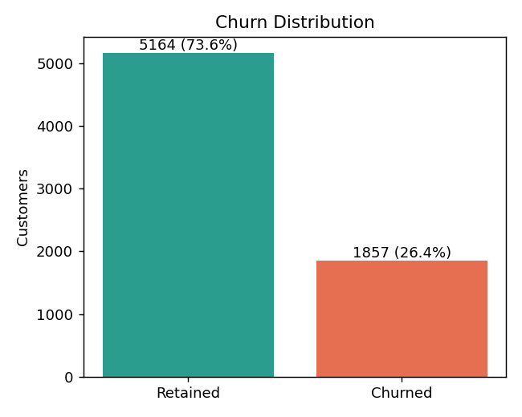

*Figure 8.1: Churn distribution in the cleaned dataset (generated by `train.py`).*

---

# 9. Methodology

The project follows a conventional supervised-learning workflow, organised so that each stage is a separate module:

1. **Data loading** (`data_loader.py`): read the CSV, verify required columns, log shape and source.
2. **Cleaning** (`data_loader.py`): correct types, handle missing values and duplicates, drop the identifier,
   encode the target.
3. **Splitting** (`preprocessing.py`): 80 % training / 20 % testing, stratified on `Churn`, `random_state = 42`.
4. **Pipeline construction** (`preprocessing.py`): preprocessing and estimator in one scikit-learn `Pipeline`.
5. **Tuning and cross-validation** (`training.py`): `RandomizedSearchCV` on the training set only.
6. **Model selection** (`training.py`): highest mean cross-validated ROC-AUC.
7. **Evaluation** (`evaluation.py`): all three tuned models scored once on the untouched test set; metrics, plots
   and feature importances saved.
8. **Persistence and tracking** (`training.py`, `experiment_tracker.py`): versioned model, metadata, experiment
   records and drift-reference statistics saved; `current.json` updated last.
9. **Serving and monitoring** (`prediction.py`, `monitoring.py`, `app.py`).

**Why selection uses cross-validation rather than the test set.** If the model were chosen using test-set scores,
the test set would no longer be an unbiased estimate of performance on new data. The test set is therefore used
only after selection, for reporting.

---

# 10. Data Preprocessing

| Step | Implementation |
|---|---|
| Missing value detection | Blank strings are converted to missing; counts are logged and stored in the cleaning report |
| Type correction | `TotalCharges` converted to a float column (non-numeric becomes missing); `SeniorCitizen` mapped from 0/1 to No/Yes so that it is treated as categorical |
| Logical handling of blanks | `TotalCharges` blank with `tenure = 0` set to 0 (a brand-new customer has not yet been billed) |
| Remaining gaps | Median imputation (numeric) and most-frequent imputation (categorical), performed **inside the pipeline** so statistics come from training folds only |
| Duplicates | Rows identical in all attributes, ignoring `customerID`, were counted and dropped (22 rows) |
| Identifier removal | `customerID` removed from the features |
| Feature separation | 3 numeric features and 16 categorical features defined centrally in `config.py` |
| Encoding | `OneHotEncoder(handle_unknown="ignore")` for categorical features |
| Scaling | `StandardScaler` for numeric features |
| Target encoding | `Churn`: No = 0, Yes = 1 |
| Splitting | 80/20, stratified, `random_state = 42` |

Because imputation, scaling and encoding live inside the `Pipeline`, they are re-fitted on each cross-validation
training fold and never see validation or test rows, which prevents data leakage. `handle_unknown="ignore"` means an
unseen category at prediction time produces an all-zero encoding instead of an error; a unit test covers this.

The same normalisation function (`normalize_features`) is applied at training and at inference time, so uploaded
batch files are interpreted exactly as the training data was.

---

# 11. Machine Learning Algorithms

## 11.1 Logistic Regression

Models P(churn) = σ(w·x + b), where σ is the logistic function. Weights are learned by minimising regularised
log-loss. It is fast and interpretable, but assumes a linear relationship between the features and the log-odds.
The regularisation strength `C` and class weighting were tuned.

## 11.2 Random Forest Classifier

An ensemble of decision trees, each trained on a bootstrap sample and considering a random subset of features at
each split; predictions are averaged. It captures non-linear effects and interactions and is robust to scaling,
but can be less well calibrated and is slower than a linear model.

## 11.3 Gradient Boosting Classifier

Builds shallow trees sequentially, each correcting the errors of the current ensemble by following the gradient of
the loss. With a small learning rate and shallow trees it often achieves the best accuracy on tabular data, at
the cost of more hyper-parameters and a risk of over-fitting if not regularised. Subsampling (`subsample`) and
minimum leaf size were tuned here.

## 11.4 Training and inference pipeline

**Training:** raw CSV → cleaning → stratified split → for each model: (imputer → scaler/one-hot encoder → estimator)
tuned by randomised search with 5-fold CV → selection by CV ROC-AUC → test-set evaluation → save.

**Inference:** input dict or CSV → validation → `normalize_features` → loaded pipeline `predict_proba` → churn
probability → retention probability (1 − p) → label (p ≥ 0.5) → risk category.

**Risk categories:** Low Risk (p < 0.30), Medium Risk (0.30 ≤ p < 0.60), High Risk (p ≥ 0.60). These bands are
simple presentation thresholds chosen for readability; they are not calibrated to business cost.

---

# 12. Hyperparameter Tuning

`RandomizedSearchCV` was used with `n_iter = 12` sampled configurations per model, `StratifiedKFold(n_splits=5,
shuffle=True, random_state=42)`, scoring = ROC-AUC, and refit on the full training set with the best
configuration. That is 60 cross-validation fits per model.

| Model | Search space | Best parameters found |
|---|---|---|
| Logistic Regression | `C` log-uniform [0.01, 100]; `class_weight` ∈ {None, balanced} | C = 21.37, class_weight = balanced |
| Random Forest | `n_estimators` 100-399; `max_depth` ∈ {4, 6, 8, 12, None}; `min_samples_leaf` 1-11; `max_features` ∈ {sqrt, log2}; `class_weight` ∈ {None, balanced} | n_estimators = 171, max_depth = 12, min_samples_leaf = 11, max_features = sqrt, class_weight = None |
| Gradient Boosting | `n_estimators` 80-299; `learning_rate` log-uniform [0.01, 0.3]; `max_depth` 2-4; `subsample` uniform [0.6, 1.0]; `min_samples_leaf` 1-11 | n_estimators = 133, learning_rate = 0.0586, max_depth = 3, subsample = 0.613, min_samples_leaf = 4 |

| Model | Mean CV ROC-AUC | CV std. dev. |
|---|---|---|
| Logistic Regression | 0.8461 | 0.0155 |
| Random Forest | 0.8485 | 0.0167 |
| **Gradient Boosting** | **0.8503** | 0.0180 |

Gradient Boosting has the highest mean CV ROC-AUC and was selected. The differences between models (about
0.002-0.004) are much smaller than the fold-to-fold standard deviation (about 0.016-0.018), so the ranking should
be read as "the three models perform similarly" rather than as evidence that Gradient Boosting is clearly superior.
The search is deliberately small to keep training to about a minute; a larger search might find better settings.

---

# 13. System Architecture

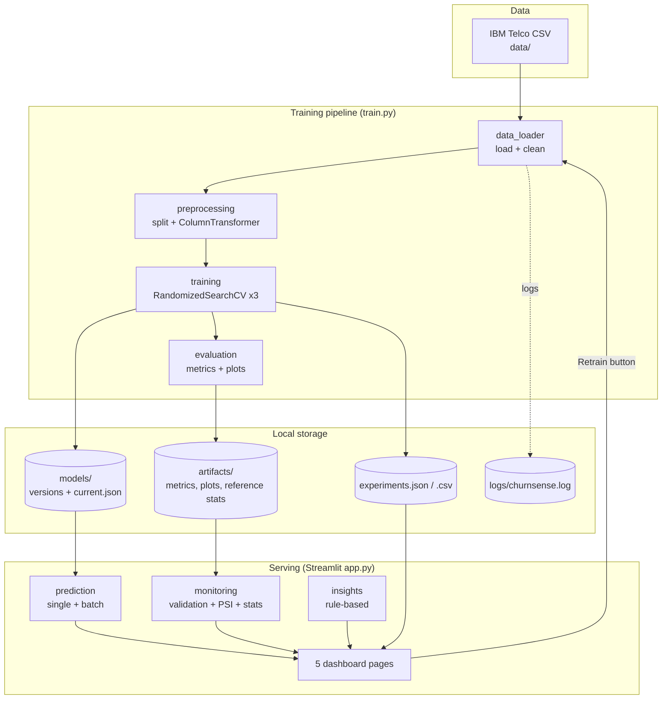

*Figure 13.1: System architecture.*

The design is deliberately layered. `config.py` holds all paths, constants and category definitions, so the
training code, the inference code and the dashboard agree on the schema. Training code never imports the
dashboard, and the dashboard calls the same functions used by the command-line tools and tests.

---

# 14. MLOps Implementation

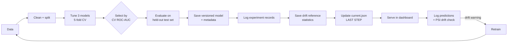

*Figure 14.1: MLOps workflow.*

## 14.1 Reproducible training pipeline

Data loading, preprocessing, training and evaluation live in separate modules and are invoked by `train.py`. The
random state is fixed (42) for the data split, the cross-validation folds, the randomised search and the
estimators. As a check, the full pipeline was run twice from a clean state during development and produced
identical metrics (CV ROC-AUC 0.8503 and test ROC-AUC 0.8426 for the selected model in both runs).

## 14.2 Model versioning

Each run saves `models/churnsense_v<YYYYMMDD_HHMMSS>.joblib` and a matching `_metadata.json` containing the model
version, training date, selected algorithm and selection criterion, hyper-parameters, CV ROC-AUC, test metrics,
dataset information (source URL, row counts, split, cleaning report), random state and library versions.
`models/current.json` is the "current model" reference read by the dashboard. It is replaced atomically (write to a
temporary file, then rename) as the very **last** step of training, so a run that fails midway leaves the previous
model active. Old model files are kept; there is no automatic clean-up.

## 14.3 Experiment tracking

`artifacts/experiments.json` (also exported to `experiments.csv`) receives one record per model per training run:
a unique experiment ID (`exp-<timestamp>-<random>`), the shared run ID, model name, hyper-parameters, CV ROC-AUC,
test metrics, timestamp, dataset summary, whether the model was selected and the model version. The dashboard shows
this history as a table.

## 14.4 Model monitoring

Implemented in `monitoring.py`:

- **Input validation.** Required columns must be present; numeric columns must be parseable and non-negative;
  unexpected category values are reported as warnings (the encoder ignores them); invalid rows are skipped and
  counted. A blank `TotalCharges` is accepted and imputed.
- **Prediction statistics.** Every prediction's probability, risk category and source (single or batch) is appended
  to `artifacts/prediction_log.csv`. The dashboard reports prediction count, high-risk count, mean probability and a
  probability histogram. Only probabilities are logged, not customer attributes.
- **PSI drift detection.** At training time, reference distributions are computed from the **training features
  only**: ten quantile bins for each numeric feature and category proportions for each categorical feature. For an
  uploaded batch, PSI = Σ (a<sub>i</sub> − e<sub>i</sub>) · ln(a<sub>i</sub> / e<sub>i</sub>) is computed per feature, with a small floor
  (1e-4) to avoid division by zero. Features are labelled Stable (< 0.10), Moderate (0.10-0.25) or Significant (≥ 0.25),
  and the dashboard shows warnings.

**Scope statement.** This is a basic academic implementation. It has no streaming ingestion, scheduled checks,
alerting, or monitoring of real outcomes, so concept drift and live accuracy are not measured. PSI values from small
uploads are noisy.

## 14.5 Automated testing

33 Pytest tests (Section 17.4) cover the pipeline from data loading to prediction and monitoring.

## 14.6 Logging

`config.setup_logging()` writes timestamped records to the console and to `logs/churnsense.log` for data loading
(including a warning when duplicates are dropped), training progress for each model, best parameters and CV
scores, model selection, evaluation metrics, saved artifacts, single predictions (probability and risk), batch
predictions (rows scored and skipped) and errors such as failed downloads or model-loading problems.

---

# 15. Technologies Used

| Component | Technology | Purpose in this project |
|---|---|---|
| Language | Python | Entire system |
| Data processing | Pandas, NumPy | Cleaning, validation, batch handling |
| Machine learning | Scikit-learn (with SciPy distributions) | Pipelines, models, randomised search, metrics |
| Persistence | Joblib | Saving/loading fitted pipelines |
| Dashboard | Streamlit | Multi-page web interface |
| Visualisation | Plotly, Matplotlib | Interactive dashboard charts; saved PNG figures |
| Experiment tracking | JSON / CSV | Local run history |
| Monitoring | Pandas + PSI | Drift and prediction statistics |
| Logging | Python `logging` | Operational log |
| Testing | Pytest | Automated tests |

Verified versions: Python 3.13, pandas 3.0.5, numpy 2.5.3, scikit-learn 1.9.1, scipy 1.18.1, streamlit 1.67.0,
plotly 7.1.0, matplotlib 3.11.2, joblib 1.6.0, pytest 9.1.1. No paid APIs, API keys, cloud credentials, GPU or
containers are required, and no external experiment-tracking or model-registry service is used.

---

# 16. Functional Requirements

| ID | Requirement | Implemented in |
|---|---|---|
| FR1 | Load/download the IBM dataset; fail clearly if unavailable (no silent substitution) | `data_loader.py`, `data/download_data.py` |
| FR2 | Clean data: missing values, duplicates, types, identifier removal, target encoding | `data_loader.py` |
| FR3 | Train three classifiers with tuning and CV; select by validation ROC-AUC | `training.py` |
| FR4 | Compute accuracy, precision, recall, F1, ROC-AUC, confusion matrix, classification report | `evaluation.py` |
| FR5 | Save versioned model, metadata and "current model" pointer | `training.py` |
| FR6 | Record each run in an experiment history | `experiment_tracker.py` |
| FR7 | Predict a single customer: churn/retention probability, status, risk category | `prediction.py`, `app.py` |
| FR8 | Batch prediction from CSV with validation, risk categories and CSV download | `prediction.py`, `app.py` |
| FR9 | Detect drift (PSI) between uploaded data and training data and warn | `monitoring.py`, `app.py` |
| FR10 | Show model comparison, confusion matrix, ROC curves, feature importance | `app.py` |
| FR11 | Show model version, experiment history, prediction statistics and warnings | `app.py` |
| FR12 | Retrain from the dashboard without breaking the current model if training fails | `training.py`, `app.py` |
| FR13 | Handle missing model files gracefully | `prediction.py`, `app.py` |
| FR14 | Provide rule-based retention insights without causal claims | `insights.py` |
| FR15 | Log data, training, selection, evaluation, prediction and errors | `config.py` + all modules |

---

# 17. Implementation Details

## 17.1 Project structure

```
ChurnSense/
  app.py, train.py, requirements.txt, README.md, PROJECT_REPORT.md, .gitignore
  data/        download_data.py, Telco-Customer-Churn.csv
  src/         config, data_loader, preprocessing, training, evaluation,
               prediction, experiment_tracker, monitoring, insights
  models/      versioned .joblib + metadata + current.json
  artifacts/   metrics.json, roc_curves.json, feature_importance.json, reference_stats.json,
               experiments.json/.csv, dataset_info.json, plots (PNG)
  logs/        churnsense.log
  tests/       conftest.py + 5 test modules
  screenshots/ screenshots of the running dashboard
```

## 17.2 Streamlit dashboard

- **Overview:** total customers (7,043), churn rate (26.5 %), retained share (73.5 %), average monthly charges
  ($64.76), churn donut chart, customers by contract type, monthly-charge and tenure distributions, and a short project
  description. (The overview describes the raw dataset of 7,043 rows; training used the 7,021 rows left after de-duplication.)
- **Churn Prediction:** a structured form; the add-on service fields are automatically set to "No internet service" /
  "No phone service" when the base service is "No", matching the dataset's coding. Output: churn probability,
  retention probability, predicted status, risk category, a gauge, a reminder that the value is an estimate and not a
  guaranteed outcome, and rule-based retention insights.
- **Batch Prediction:** CSV upload with a downloadable template, validation messages, results table, risk
  histogram, CSV download of predictions, and an automatic drift check against the training reference.
- **Model Performance:** comparison table (selected model starred), grouped metric chart, confusion matrix of the
  selected model, ROC curves of all models, feature importance per model, classification report.
- **MLOps Monitoring:** current model version, algorithm, last training time and test ROC-AUC; experiment history;
  prediction statistics; PSI drift report from the most recent batch upload; consolidated warnings; and a Retrain
  button. Model information is cached in Streamlit and cleared after retraining.

## 17.3 Retention insights

`insights.py` applies simple rules to a customer's attributes (month-to-month contract, tenure ≤ 12 months, monthly
charges ≥ $80, internet service without tech support or online security, electronic-check payment, fibre-optic service
for non-low-risk customers) and returns an observation and a general suggestion for each rule that fires. The rules
are heuristics motivated by patterns commonly seen in churn data (and visible in this model's feature importances);
they are not causal explanations, and the suggestions are ideas to consider, not guaranteed interventions.

## 17.4 Automated tests

| Test module | Tests | What is covered |
|---|---|---|
| `test_data_loader.py` | 6 | Real data loads with expected columns; missing file and missing columns raise errors; cleaning removes the identifier and encodes the target; blank `TotalCharges` handling; `SeniorCitizen` normalisation |
| `test_preprocessing.py` | 5 | 80/20 stratified reproducible split; finite numeric output; scaler fitted on training data only; unseen category tolerated; feature names match the model's width |
| `test_model.py` | 7 | Model/metadata/pointer files saved; model loads; missing model raises a clean error; metadata content; selection follows CV, not test, scores; all three models tracked with exactly one selected; reference statistics created |
| `test_prediction.py` | 9 | Single-prediction output validity (probabilities sum to 1, valid risk category); invalid input rejected; high-risk profile scores above a loyal profile; batch prediction output; missing columns rejected; invalid rows skipped; blank `TotalCharges` accepted; risk thresholds; insight rules |
| `test_monitoring.py` | 6 | PSI of identical distributions is 0 and large for shifts; no drift on identical data; drift detected on shifted data; validation reports missing columns and unexpected values; prediction statistics from the log |
| **Total** | **33** | **33 passed** |

The tests train a quick model (1 search iteration, 2 folds) into a temporary directory, so they do not modify the
project's real model files. During development the suite initially found a real bug (blank `TotalCharges` values
produced a missing value in the validity mask, silently dropping those rows), which was fixed before the final
results were produced.

---

# 18. Results and Evaluation

All figures below were generated by `python train.py` (run `v20261111_004136`) on 1,405 held-out customers that
were not used for tuning or selection.

## 18.1 Model comparison

| Model | CV ROC-AUC | Accuracy | Precision | Recall | F1 | Test ROC-AUC |
|---|---|---|---|---|---|---|
| Logistic Regression | 0.8461 | 0.7381 | 0.5035 | 0.7823 | 0.6126 | 0.8398 |
| Random Forest | 0.8485 | 0.7957 | 0.6557 | 0.4812 | 0.5550 | 0.8395 |
| **Gradient Boosting (selected)** | **0.8503** | **0.7993** | **0.6596** | **0.5000** | **0.5688** | **0.8426** |

Precision, recall and F1 refer to the churn class at a 0.5 threshold.

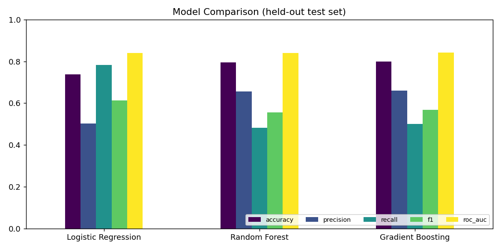

*Figure 18.1: Model comparison on the held-out test set.*

## 18.2 Selected model: confusion matrix and classification report

| | Predicted Retained | Predicted Churned |
|---|---|---|
| **Actual Retained** | 937 | 96 |
| **Actual Churned** | 186 | 186 |

| Class | Precision | Recall | F1 | Support |
|---|---|---|---|---|
| Retained | 0.8344 | 0.9071 | 0.8692 | 1,033 |
| Churned | 0.6596 | 0.5000 | 0.5688 | 372 |
| Macro average | 0.7470 | 0.7035 | 0.7190 | 1,405 |
| Weighted average | 0.7881 | 0.7993 | 0.7897 | 1,405 |

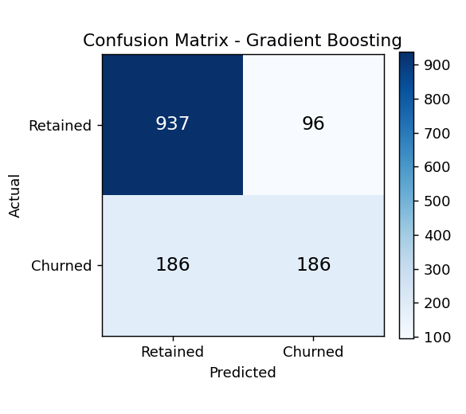

*Figure 18.2: Confusion matrix of Gradient Boosting on the test set.*

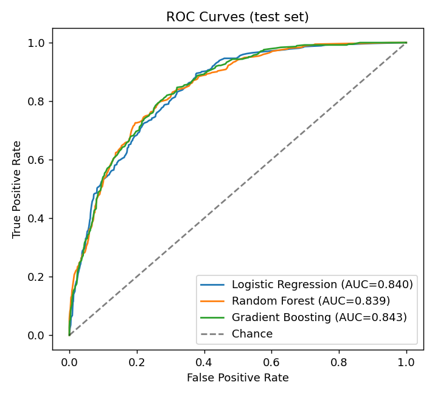

*Figure 18.3: ROC curves of the three models (test AUC: LR 0.840, RF 0.839, GB 0.843).*

## 18.3 Interpretation

- All three models rank customers similarly well (test ROC-AUC 0.840, 0.839 and 0.843 for Logistic Regression,
  Random Forest and Gradient Boosting). Their differences are within the cross-validation noise.
- The metrics reflect a trade-off at the fixed 0.5 threshold. The selected Gradient Boosting model is the most
  accurate (0.799) and precise (0.660) but finds only half of the actual churners (recall 0.500). Logistic
  Regression, tuned with balanced class weights, finds 78 % of churners (recall 0.782) at the cost of many more false
  alarms (precision 0.504). Which behaviour is preferable depends on the relative costs of missing a churner versus
  contacting a customer who would have stayed. That cost was not modelled here.
- The accuracy of 0.799 should be read against the base rate: always predicting "Retained" would score roughly 73.5 %
  on this data.

## 18.4 Feature importance

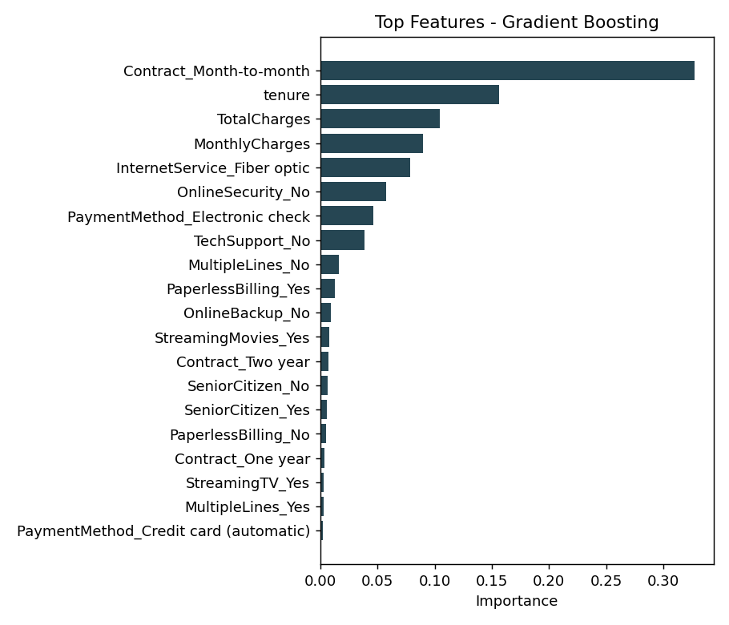

*Figure 18.4: Top features of the selected model (impurity-based importance).*

For Gradient Boosting the most important features were `Contract_Month-to-month` (0.327), `tenure` (0.156),
`TotalCharges` (0.105), `MonthlyCharges` (0.090), `InternetService_Fiber optic` (0.079), `OnlineSecurity_No` (0.057),
`PaymentMethod_Electronic check` (0.047) and `TechSupport_No` (0.038). Random Forest gave a similar ordering
(tenure, TotalCharges, month-to-month contract, MonthlyCharges, no online security). These importances describe what
the models rely on; they do **not** show that changing a feature would change a customer's behaviour. Tree-based
importances are also known to be affected by correlated features; `TotalCharges` is naturally related to `tenure`
and `MonthlyCharges`.

## 18.5 Monitoring demonstration

To demonstrate drift detection, the first 300 rows of the dataset were scored; every feature was reported as
Stable (maximum PSI 0.032, for `TotalCharges`). A **deliberately altered copy** of the same 300 rows (monthly charges
inflated, total charges scaled, all contracts set to month-to-month, tenure capped at 10 months) was then uploaded.
The altered file is artificial demonstration data and not a real customer sample. PSI flagged `tenure` (6.37),
`MonthlyCharges` (3.89) and `Contract` (3.76) as significant drift and `TotalCharges` (0.246) as moderate drift,
while the features that were not altered stayed stable (maximum PSI 0.0125). This confirms the drift check responds
to distribution shifts; it says nothing about how often real drift occurs.

---

# 19. Dashboard Screenshots

The screenshots below were captured from the running application (Streamlit, headless Chrome) after training.
The batch pages use the first 300 rows of the IBM dataset; screenshot 3b uses the artificially altered demonstration
file described in Section 18.5.

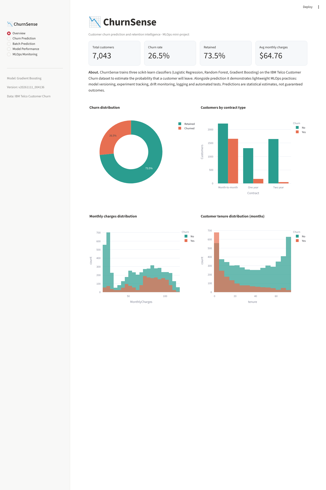

*Figure 19.1: Overview dashboard.*

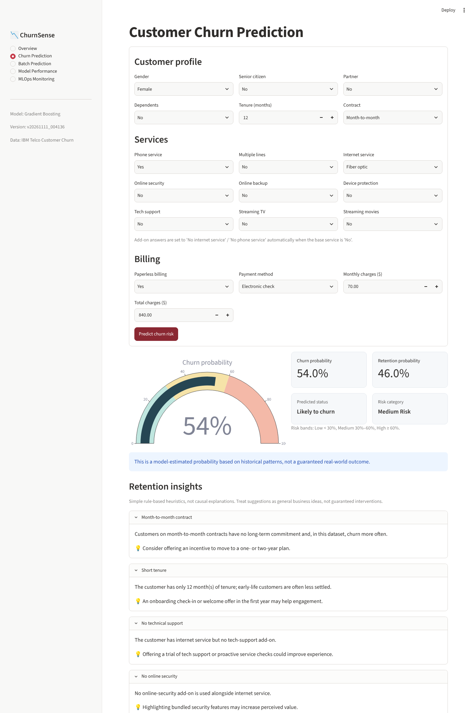

*Figure 19.2: Single-customer prediction with risk category and retention insights (example profile entered by the author).*

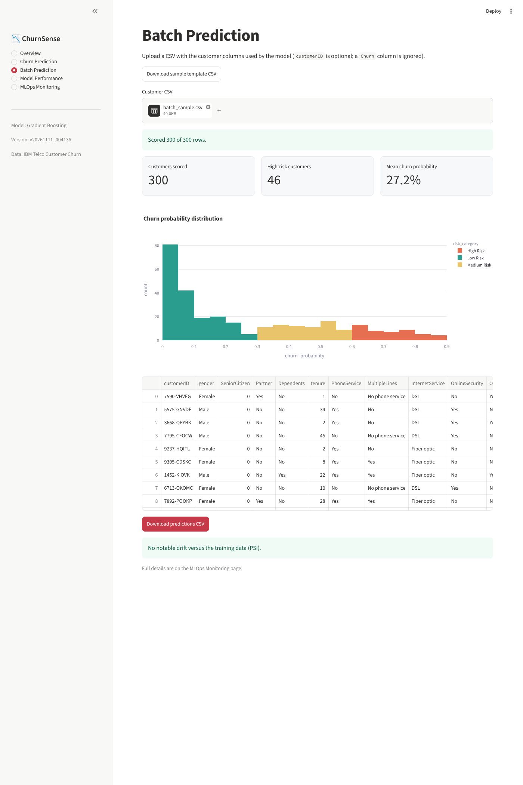

*Figure 19.3: Batch prediction on 300 customers.*

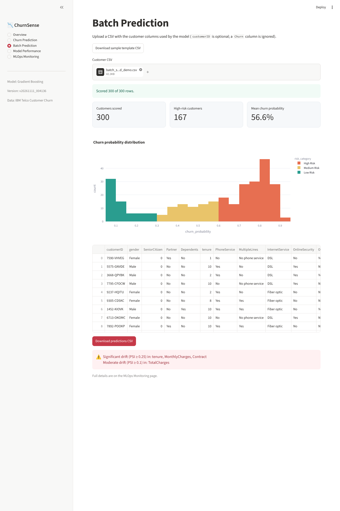

*Figure 19.4: Drift warning for the deliberately altered demonstration file.*

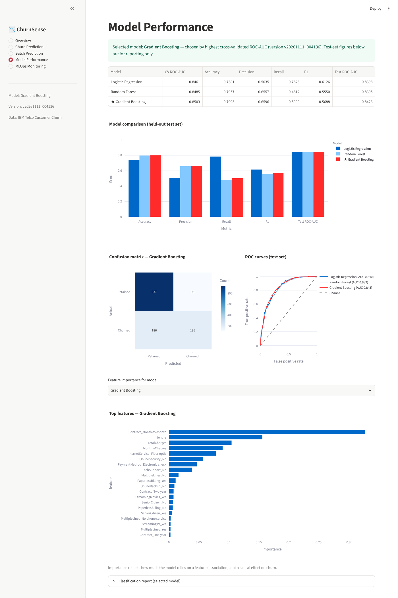

*Figure 19.5: Model performance page with the selected model starred.*

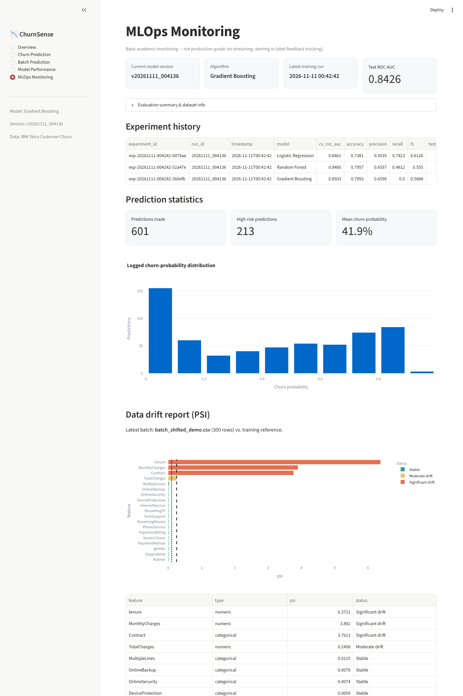

*Figure 19.6: MLOps monitoring page (model version, experiment history, prediction statistics, PSI drift report).*

---

# 20. Limitations

**Data.**
- One historical snapshot from a single telecom provider with 7,021 usable rows; there is no date information, so
  time-based validation and genuine drift over time cannot be studied.
- The 22 rows removed as duplicates differ only in `customerID`; dropping them was a design decision, and they could
  in principle be distinct customers with identical attributes.
- The dataset is a published sample; its collection process and any selection bias are not documented here.

**Model.**
- At the 0.5 threshold, churn recall is 0.50. The decision threshold was not optimised and no business cost model
  was used; the 0.30/0.60 risk bands are presentation choices.
- The three models differ by less than the cross-validation spread, so the selection of Gradient Boosting is not
  statistically decisive. Only a small randomised search (12 configurations per model) was run.
- Probabilities were not explicitly calibrated, so a predicted 54 % should not be read as an exact 54 % chance.
- Feature importances and the rule-based insights are associations in historical data, not causal effects.
- Only the models' behaviour on this single random split was reported; repeated splits or confidence intervals
  would give a better idea of variability.

**MLOps.**
- Monitoring is basic and academic: PSI on uploaded batches against a training reference, with conventional
  thresholds, noisy on small samples. There is no alerting, scheduling, concept-drift or live-outcome tracking.
- Each training run overwrites the plots and drift-reference files in `artifacts/`; versioned models and the
  experiment history are retained, but the reference statistics are not versioned per model.
- Model files are pickled scikit-learn objects and may not load on a different scikit-learn version; the application
  detects this and asks the user to retrain.
- Experiment tracking and the "registry" are local files; there is no multi-user access control or locking.
- Prediction logging records probabilities and risk categories only, so monitoring of input data relies on the
  uploaded files being compared at upload time.

**Verification scope.** The training pipeline, the 33 tests and every dashboard page (via Streamlit's headless test
runner and a real headless Chrome session, including the prediction form and CSV upload) were exercised in the
development environment. The Retrain button was exercised through Streamlit's test runner on a copy of the project:
it produced a new model version, appended three experiment records and kept the previous model file. The button was
not clicked in a real browser session. Other operating systems, browsers and older library versions were not tested.

---

# 21. Future Enhancements

1. Tune the decision threshold against an explicit cost matrix (cost of a missed churner vs. cost of a retention
   offer) and report expected business value.
2. Probability calibration (Platt or isotonic) and calibration plots.
3. Larger searches, additional models (for example histogram-based gradient boosting) and repeated cross-validation
   with confidence intervals.
4. Explainability for individual predictions, for example permutation importance or SHAP, while keeping the
   correlation-not-causation caveat.
5. Versioned drift-reference statistics per model, and automatic comparison of a new model against the current one
   before promotion.
6. Scheduled monitoring jobs, alert notifications and, where outcomes become available, live performance tracking.
7. Time-aware splitting if dated data becomes available.
8. Containerisation and CI (running `pytest -q` on every commit) if deployment beyond a classroom demo is wanted.

---

# 22. Conclusion

ChurnSense demonstrates that a compact, reproducible system can combine a sound modelling workflow with the
essential elements of MLOps. Using the real IBM Telco Customer Churn dataset, three scikit-learn classifiers were
tuned and compared with cross-validation, and Gradient Boosting was selected on validation ROC-AUC (0.8503). On an
untouched test set it achieved an accuracy of 0.7993 and a ROC-AUC of 0.8426, with churn precision 0.6596 and recall
0.5000. These results are respectable but show clear limits: half of the churners are missed at the default threshold,
and the three models are statistically close.

The surrounding system, with versioned models and metadata, experiment tracking, safe retraining, input validation,
PSI-based drift checks, logging, a 33-test Pytest suite and a five-page dashboard, shows how a model can be made
traceable, testable and observable without heavy infrastructure. The monitoring and insights are intentionally simple
and are not a substitute for production-grade tooling or for causal analysis. The project provides a solid base for the
future enhancements listed above.

---

# 23. References

1. IBM. *Telco Customer Churn on ICP4D* (IBM Telco Customer Churn dataset). GitHub repository:
   <https://github.com/IBM/telco-customer-churn-on-icp4d>. Data file:
   <https://raw.githubusercontent.com/IBM/telco-customer-churn-on-icp4d/master/data/Telco-Customer-Churn.csv>.
2. Pedregosa, F., et al. (2011). Scikit-learn: Machine Learning in Python. *Journal of Machine Learning Research*,
   12, 2825-2830.
3. Scikit-learn documentation. <https://scikit-learn.org/stable/> (Pipeline, ColumnTransformer, OneHotEncoder,
   StandardScaler, RandomizedSearchCV, LogisticRegression, RandomForestClassifier, GradientBoostingClassifier,
   metrics).
4. Streamlit documentation. <https://docs.streamlit.io/>
5. Plotly Python documentation. <https://plotly.com/python/>
6. pandas documentation. <https://pandas.pydata.org/docs/>
7. Joblib documentation. <https://joblib.readthedocs.io/>
8. pytest documentation. <https://docs.pytest.org/>
9. Cox, D. R. (1958). The regression analysis of binary sequences. *Journal of the Royal Statistical Society,
   Series B*, 20(2), 215-242.
10. Breiman, L. (2001). Random forests. *Machine Learning*, 45(1), 5-32.
11. Friedman, J. H. (2001). Greedy function approximation: A gradient boosting machine. *Annals of Statistics*,
    29(5), 1189-1232.
12. Bergstra, J., & Bengio, Y. (2012). Random search for hyper-parameter optimization. *Journal of Machine Learning
    Research*, 13, 281-305.
13. Sculley, D., et al. (2015). Hidden technical debt in machine learning systems. *Advances in Neural Information
    Processing Systems 28*.
14. Siddiqi, N. (2006). *Credit Risk Scorecards: Developing and Implementing Intelligent Credit Scoring*. Wiley.

*Bibliographic details for items 9-14 were written from the author's knowledge of these standard works and should
be checked against the original sources before final submission.*
