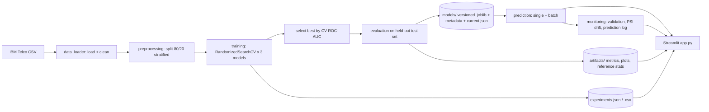

# ChurnSense: Customer Churn Prediction and Retention Intelligence System

An undergraduate AI & ML **MLOps mini-project**. ChurnSense trains three scikit-learn classifiers on the
IBM Telco Customer Churn dataset, picks the best one using cross-validated ROC-AUC, and serves it through a
Streamlit dashboard with lightweight MLOps features: model versioning, experiment tracking, PSI-based drift
monitoring, logging and automated tests. Everything runs locally: no API keys, cloud accounts, GPU or Docker.

> Predictions are statistical estimates learned from historical data. They are **not** guaranteed outcomes,
> and feature importance / retention insights describe association, **not causation**.

 [Click to open live demo](https://churnsens.streamlit.app/ "Hover Title")

## Results (actual output of `python train.py`)

Selected model: **Gradient Boosting** (chosen by highest 5-fold cross-validated ROC-AUC on the training set).
Test-set figures come from the untouched 20 % hold-out (1,405 customers) and were used for reporting only.

| Model | CV ROC-AUC | Accuracy | Precision | Recall | F1 | Test ROC-AUC |
|---|---|---|---|---|---|---|
| Logistic Regression | 0.8461 | 0.7381 | 0.5035 | 0.7823 | 0.6126 | 0.8398 |
| Random Forest | 0.8485 | 0.7957 | 0.6557 | 0.4812 | 0.5550 | 0.8395 |
| **Gradient Boosting** (selected) | **0.8503** | **0.7993** | **0.6596** | **0.5000** | **0.5688** | **0.8426** |

Precision / recall / F1 refer to the "Churned" class at a 0.5 probability threshold. The three models are very
close (CV standard deviation is about 0.016-0.018, larger than the gaps between models), so the choice of
Gradient Boosting follows the stated selection rule rather than showing a decisive win.

## Features

- Reproducible pipeline: separate modules for loading, preprocessing, training, evaluation; fixed seed 42.
- Leak-free preprocessing: `ColumnTransformer` inside a scikit-learn `Pipeline` (imputation, `StandardScaler`,
  `OneHotEncoder`), fitted only on training folds.
- Three models tuned with `RandomizedSearchCV` (5-fold stratified CV, scoring = ROC-AUC).
- Model versioning with Joblib, metadata JSON and a `current.json` pointer.
- JSON/CSV experiment tracking (one record per model per run).
- Monitoring: input validation, prediction statistics, PSI drift check of uploaded batches vs. training data.
- Python logging to console and `logs/churnsense.log`.
- Pytest suite (33 tests).
- Five-page Streamlit dashboard: Overview, Churn Prediction, Batch Prediction, Model Performance, MLOps Monitoring.
- Rule-based retention insights (heuristic suggestions, not causal claims).

## Architecture



## Technology stack

| Component | Technology |
|---|---|
| Language | Python |
| Data processing | Pandas, NumPy |
| Machine learning | Scikit-learn (SciPy for search distributions) |
| Model persistence | Joblib |
| Dashboard | Streamlit |
| Visualisation | Plotly (dashboard), Matplotlib (saved PNGs) |
| Experiment tracking | JSON / CSV |
| Monitoring | Pandas + PSI |
| Logging | Python `logging` |
| Testing | Pytest |

## Project structure

```
ChurnSense/
├── app.py                  # Streamlit dashboard
├── train.py                # CLI training entry point
├── requirements.txt
├── README.md
├── PROJECT_REPORT.md       # Academic mini-project report
├── .gitignore
├── data/
│   ├── download_data.py    # downloads the real IBM dataset
│   └── Telco-Customer-Churn.csv
├── src/
│   ├── config.py           # paths, constants, categories, thresholds, logging setup
│   ├── data_loader.py      # loading, type correction, cleaning, dataset info
│   ├── preprocessing.py    # ColumnTransformer / Pipeline / split
│   ├── training.py         # tuning, selection, versioning, tracking
│   ├── evaluation.py       # metrics + matplotlib plots
│   ├── prediction.py       # model loading, single and batch inference
│   ├── experiment_tracker.py
│   ├── monitoring.py       # validation, PSI drift, prediction stats
│   └── insights.py         # rule-based retention insights
├── models/                 # versioned models + current.json
├── artifacts/              # metrics, ROC data, plots, reference stats, experiments
├── logs/                   # churnsense.log (created at run time)
├── tests/                  # pytest suite
└── screenshots/            # real screenshots of the running app
```

## Dataset

IBM Telco Customer Churn (IBM Cloud Pak for Data sample dataset), 7,043 customers x 21 columns, target `Churn`.

- Repository: <https://github.com/IBM/telco-customer-churn-on-icp4d>
- Raw CSV: <https://raw.githubusercontent.com/IBM/telco-customer-churn-on-icp4d/master/data/Telco-Customer-Churn.csv>

The CSV is already included at `data/Telco-Customer-Churn.csv`. To re-download it:

```bash
python data/download_data.py
```

If you are offline, download the CSV from the URL above and save it as `data/Telco-Customer-Churn.csv`.
**No synthetic data is ever substituted**; if the file is missing and cannot be downloaded the code stops with a
clear error.

## Installation

Python 3.11+ is recommended (developed and tested on Python 3.13).

```bash
# from the project root (the folder containing app.py)
python -m venv .venv
# Windows:      .venv\Scripts\activate
# macOS/Linux:  source .venv/bin/activate

pip install -r requirements.txt
```

## Train the models

```bash
python train.py                      # full run (about 1-2 minutes)
python train.py --n-iter 4 --cv 3    # quicker, lighter search
```

This trains and tunes all three models, selects the best by cross-validated ROC-AUC, evaluates on the test set,
saves a new versioned model, appends experiment records, writes metrics / plots / drift reference statistics,
and finally updates `models/current.json`. A model is already included, so you can skip straight to the
dashboard, but **re-run `python train.py` if you use different library versions** (see Troubleshooting).

## Run the dashboard

```bash
streamlit run app.py
```

Open <http://localhost:8501>. Pages: **Overview**, **Churn Prediction**, **Batch Prediction**,
**Model Performance**, **MLOps Monitoring** (the last one includes a **Retrain model** button).

For batch prediction, upload a CSV with the columns of the original dataset (`customerID` optional, `Churn`
ignored). A template can be downloaded from the Batch Prediction page.

## Run the tests

```bash
pytest -q
```

33 tests cover data loading, cleaning, preprocessing, model saving/loading, single and batch prediction,
output validation, experiment tracking, PSI drift and input validation. The tests train a small, fast model in a
temporary directory, so they never overwrite the project's real model.

## MLOps capabilities

| Capability | Where | How it works |
|---|---|---|
| Reproducible training | `train.py`, `src/training.py` | Fixed seed (42), stratified split, separated modules |
| Model versioning | `models/` | `churnsense_v<timestamp>.joblib` + `_metadata.json`; `current.json` points to the active version |
| Experiment tracking | `artifacts/experiments.json`, `.csv` | One record per model per run: ID, hyperparameters, CV and test metrics, timestamp, dataset info |
| Safe retraining | `src/training.py`, dashboard button | `current.json` is replaced atomically as the very last step, so a failed run keeps the old model |
| Monitoring | `src/monitoring.py`, dashboard | Input validation, prediction counts, probability histogram, high-risk count |
| Drift detection | `src/monitoring.py` | PSI per feature vs. training reference (10 quantile bins for numeric, category shares for categorical) |
| Logging | `logs/churnsense.log` | Data loading, training progress, model selection, evaluation, predictions, warnings/errors |
| Automated tests | `tests/` | Pytest |

PSI interpretation used: < 0.10 stable, 0.10-0.25 moderate, >= 0.25 significant (common rule of thumb).

**Important:** this is a *basic academic* monitoring implementation, not production-grade monitoring. It has no
streaming, alerting, scheduled checks, or tracking of real outcomes (concept drift / live accuracy).

## Troubleshooting

| Problem | Fix |
|---|---|
| `ModuleNotFoundError: No module named 'src'` | Run commands from the project root (the folder containing `app.py`). |
| "No trained model is available" in the app | Run `python train.py`, or press **Retrain model** on the MLOps Monitoring page. |
| "Model file ... could not be loaded" or a scikit-learn version warning in the log | The shipped model was trained with scikit-learn 1.9.1. Run `python train.py` to retrain with your versions. |
| `Dataset not found` / download fails | Download the CSV manually from the URL in the Dataset section into `data/`. |
| Streamlit warns about `width="stretch"` / unknown argument | Upgrade Streamlit: `pip install -U "streamlit>=1.50"`. |
| Training feels slow | Use `python train.py --n-iter 4 --cv 3`. |
| Port 8501 in use | `streamlit run app.py --server.port 8502` |
| Dashboard shows a drift warning on a tiny upload | PSI is noisy for small samples; use a few hundred rows or more. |

## Known limitations

- Single historical dataset from one telecom provider; no time dimension, so drift and generalisation to other
  populations or later periods are untested.
- At the default 0.5 threshold, churn recall for the selected model is 0.50: half of the customers who actually
  churned in the test set are missed. The threshold is not tuned for any business cost.
- Differences between the three models are smaller than the cross-validation spread.
- Retention insights are fixed heuristic rules and feature importance indicates association, not causation.
- Each training run overwrites the plots and reference statistics in `artifacts/` (model files and experiment
  history are kept).

## Verified environment

Developed and verified on Python 3.13 with pandas 3.0.5, numpy 2.5.3, scikit-learn 1.9.1, scipy 1.18.1,
streamlit 1.67.0, plotly 7.1.0, matplotlib 3.11.2, joblib 1.6.0, pytest 9.1.1. Older versions allowed by
`requirements.txt` were not tested.
